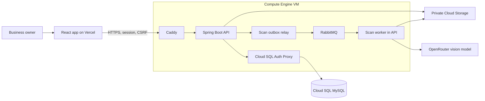
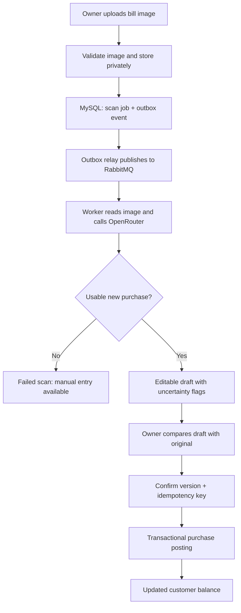
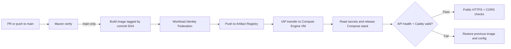

# Baakio Backend 

**A reliable ledger behind Baakio's customer credit experience.**

[Website](https://www.baakio.shop/) · [Frontend repository](https://github.com/sanjaygupta45/Baakio-fe) · [API routes](docs/API.md) · [Deployment runbook](deploy/vm/README.md)

## From business problem to backend feature

| Business need | API capability |
| --- | --- |
| Know the real balance after repeat purchases and part payments | Customer ledger with opening balances, quick or itemized purchases, confirmed payments, and dated statements. |
| Remember who promised to pay | Payment commitments with due dates, reschedule history, allocations, and prioritized follow-ups. |
| Enter a handwritten bill faster | Private image upload → asynchronous OCR → editable draft → owner-confirmed purchase. |
| Explain a balance to a customer | Date-range statement data and English/Hindi WhatsApp reminder previews, with confirmed UPI details when available. |
| Keep records separate and trustworthy | Business-scoped access, passwordless sign-in, server-side sessions, CSRF checks, and idempotent financial writes. |

## System architecture

**Stack:** Java 21 · Spring Boot 4 · Spring Security · Hibernate/JPA · Flyway · MySQL 8.4 · RabbitMQ. MySQL holds the financial source of truth; Redis is not used for balance decisions.

## AI scan: image to confirmed purchase

- **Input:** One JPEG, PNG, or WebP image up to 10 MB. The original stays in private Cloud Storage; image and scan access are scoped to the business.
- **Reliable queue:** The scan job and outbox event commit together. The relay marks delivery only after RabbitMQ confirms routing. Stale worker claims can be retried.
- **Review, not blind automation:** OCR proposes structured fields. The server rejects non-purchase documents, flags uncertain values or total mismatches, and recalculates item totals with `BigDecimal`.
- **One financial write:** Upload and extraction do not change debt. The owner edits the draft and confirms it; version checks and idempotency guard the final posting. Any payment on the bill needs explicit confirmation.
- **Retention:** Unkept source images are deleted after 30 days by default. Manual purchase entry remains available if extraction fails.

## Ledger safeguards

- Posted purchases and confirmed payments are append-only. Promises and payment allocations are tracked separately, so a promise never reduces debt.
- Financial writes lock the customer row, validate the current balance, use an `Idempotency-Key`, and commit an audit event in the same transaction.
- Money calculations use decimal values and round line totals to paise. The server computes balances and statement totals.
- MySQL-backed sessions, CSRF tokens, exact allowed browser origins, and business-scoped queries protect account data.

## Deployment flow

The VM runs **Caddy, the API, RabbitMQ, and Cloud SQL Auth Proxy**. Cloud SQL hosts MySQL; a private bucket stores bill images. The frontend has a [separate Vercel workflow](https://github.com/sanjaygupta45/Baakio-fe/blob/main/.github/workflows/deploy-vercel.yml). GitHub Actions uses short-lived Google Cloud credentials; the VM uses its service account to read runtime secrets and access its bucket.

**Operations:** Cloud SQL managed backups, uptime and TLS alerts, VM telemetry, and a five-minute watch service. The single VM is a pilot-scale single point of failure. See the [deployment runbook](deploy/vm/README.md) for provisioning, verification, rollback, and recovery.

## API at a glance

| Area | Representative routes |
| --- | --- |
| Authentication and settings | `/api/v1/auth/*`, `/api/v1/account-holder/*`, `/api/v1/business` |
| Customers and ledger | `/api/v1/customers`, `/api/v1/customers/{id}/purchases`, `/api/v1/customers/{id}/payments`, `/api/v1/customers/{id}/ledger` |
| Promises and follow-ups | `/api/v1/customers/{id}/commitments`, `/api/v1/commitments/{id}/reschedule`, `/api/v1/dashboard` |
| Bill scanning | `/api/v1/customers/{id}/scans`, `/api/v1/scans/{id}`, `/api/v1/scans/{id}/confirm` |
| Reminder preview | `/api/v1/customers/{id}/reminder-preview` |

See [all API routes](docs/API.md). The test suite covers authentication, security, scan drafting and processing, and scan/ledger consistency; CI runs Maven verification before deployment.
