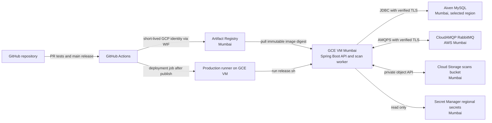

# Backend target architecture: GCP, Aiven MySQL, CloudAMQP RabbitMQ

Status: proposed on 2026-10-09. This design interprets "clouldMQ" as
[CloudAMQP](https://www.cloudamqp.com/), the managed RabbitMQ provider discussed
with the operator. It replaces the earlier plan to run MySQL and RabbitMQ on the
GCE VM. No cloud or provider resources have been created for this design.

## Deployment boundary

The first backend release runs in Mumbai and is checked over VM localhost. A
public API hostname, public ingress, SMS delivery, OCR credentials, frontend
deployment, and database backup automation remain separate follow-up work.
Managed Aiven plans include provider backups; no additional database backup
pipeline is planned here.

GitHub Actions is the selected automation path because the repository
already has a test, publish, and deployment workflow. The first release is
manual; the workflow is enabled only after the managed connections and VM
release checks work. The production runner accepts only the protected `main`
deployment job, never pull request jobs. It connects outbound to GitHub, so no
CI-specific inbound firewall rule is needed.

## Services and placement

| Component | Initial choice | Reason and limit |
| --- | --- | --- |
| API and scan worker | One GCE VM in `asia-south1`; evaluate `e2-small` (2 GiB) after a memory test, otherwise use `e2-medium` (4 GiB) | The RabbitMQ listener and scheduled outbox relay need a continuously running process. Only the backend container runs on this VM. |
| Boot disk and network | 20-30 GiB zonal `pd-balanced`, attached static external IPv4, SSH limited to the operator IP, API on `127.0.0.1:8080` | The disk holds the OS, Docker images, and logs, but no MySQL or RabbitMQ data. The static address gives Aiven a stable source IP to allowlist and can later serve the API hostname. |
| MySQL | Aiven for MySQL, region-selectable paid plan in GCP Mumbai (`google-asia-south1`) | The free and $5 Developer plans do not let us choose a region and cannot satisfy the India placement requirement. Allowlist the VM's static IPv4. Confirm the exact Mumbai plan price and backup location in Aiven before ordering. |
| RabbitMQ | CloudAMQP RabbitMQ in AWS Mumbai (`ap-south-1`) | The free Little Lemur shared plan is suitable for initial validation, subject to its message, queue, and connection limits. Decide on a paid plan before production traffic. |
| Scan files | Private Standard Cloud Storage bucket in `asia-south1`, uniform bucket access and public access prevention | Required by the application's GCS readiness check even before OCR is configured. |
| Images | Private Docker Artifact Registry repository in `asia-south1` | Store immutable release images and grant the VM read access only. |
| Secrets | Regional Secret Manager in `asia-south1` for the Aiven password, CloudAMQP credential, and OTP hash secret | VM identity reads only these secrets and writes a local `0600` runtime environment. No service-account key or credentials in Git. |
| Redis | Do not provision yet | Production code does not currently use Redis; Upstash can be added when a concrete caching use case exists. |

The chosen Aiven and CloudAMQP endpoints are in India but are reached across
provider networks. Use verified TLS for both. Restrict Aiven's MySQL endpoint
to the VM's static IPv4. Confirm each provider's backup,
replica, and log location if India-only storage is a strict requirement. Do not
place customer data in CI logs or images.

## Release and access design

1. A pull request runs Maven verification on a GitHub-hosted runner. It has no
   production credentials or VM access.
2. A merge to protected `main` builds an amd64 backend image. GitHub OIDC uses
   GCP Workload Identity Federation to impersonate a dedicated publisher
   identity. That identity can write only to the Mumbai Artifact Registry
   repository. No long-lived GCP key is used.
3. The deployment job on the GCE runner receives the exact image digest, pulls
   it with the VM identity, and runs `release.sh`. The VM identity has
   `roles/artifactregistry.reader` on the repository,
   `roles/storage.objectUser` on the scan bucket, and Secret Manager accessor
   on the named secrets only.
4. Release checks require readiness (MySQL, RabbitMQ, GCS), CSRF bootstrap,
   and unauthenticated API protection over localhost. The successful digest
   and timestamp are recorded on the VM. A failed release restores the prior
   image only if no Flyway migration advanced; otherwise it stops the API for
   controlled recovery.

The first manual deployment uses the same image digest and release script as
automation. CI setup must not block this initial validation.

## Required repository changes before deployment

- `compose.prod.yaml`: remove local MySQL and RabbitMQ containers, volumes,
  health dependencies, and root password. Inject the Aiven JDBC URL and
  CloudAMQP host, port, virtual host, and credentials into the API.
- `application.properties`: enable verified TLS for JDBC and AMQPS and expose
  RabbitMQ virtual-host configuration. Keep the readiness dependencies.
- `release.sh`: stop starting local dependencies and replace its `docker
  compose exec mysql` Flyway rank query with a TLS-verified query to Aiven.
  Preserve the migration-aware rollback behavior.
- `init-env.sh` and production environment documentation: obtain external
  service credentials from regional Secret Manager; keep nonsecret endpoint
  settings in the VM configuration. Never commit actual credentials.
- Verify external connectivity, schema migration, queue declaration,
  publisher confirm, readiness, CSRF, and protected API behavior before
  enabling automatic deploys.

## Cost boundary

The earlier all-in-one Mumbai VM estimate was about $36.63/month before usage.
With the database and broker managed externally, a successful `e2-small` memory
test could lower the GCP VM/disk/IP baseline to roughly $21-22/month; an
`e2-medium` keeps the roughly $36.63/month GCP baseline. Aiven's first
region-selectable MySQL plan starts at $19/month, with the actual GCP Mumbai
quote to be confirmed. CloudAMQP Little Lemur is free within its development
limits; the next shared plan starts at $19/month. Thus a low-cost initial
configuration starts around $40-41/month with the free broker, or $59-60/month
with Tough Tiger, before usage-based charges. These are entry-level plans; the
free broker is labeled for development and neither shared broker plan provides
a dedicated high-availability broker. Aiven recommends a higher plan for
production workloads. GCS storage and operations, Artifact Registry storage
above its free allowance, and inter-provider network traffic are additional.
Secret Manager's first six active versions and 10,000 monthly access operations
are free per billing account, and Artifact Registry includes 0.5 GiB-month of
free stored images. GCE's Always Free VM and Cloud Storage free storage apply
only in eligible US regions, so neither makes the Mumbai VM or scan bucket
free. Google Cloud billing is still disabled for the likely `baakio` project.

Sources checked 2026-10-09: [Aiven MySQL pricing](https://aiven.io/pricing/mysql),
[Aiven regions](https://aiven.io/docs/platform/reference/list_of_clouds),
[CloudAMQP plans and regions](https://www.cloudamqp.com/plans/),
[CloudAMQP TLS](https://www.cloudamqp.com/docs/faq/),
[Aiven IP allowlist](https://aiven.io/docs/platform/howto/restrict-access),
[GCP E2 pricing](https://cloud.google.com/products/compute/pricing/general-purpose),
[GCP external IP pricing](https://cloud.google.com/vpc/network-pricing),
[GCP Free Tier regions](https://docs.cloud.google.com/free/docs/free-cloud-features),
[Artifact Registry pricing](https://cloud.google.com/artifact-registry/pricing),
[Secret Manager pricing](https://cloud.google.com/secret-manager/pricing), and
[GCP Workload Identity Federation](https://docs.cloud.google.com/iam/docs/workload-identity-federation-with-deployment-pipelines).
