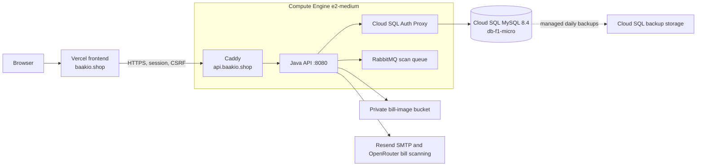

# Baakio single-VM production runbook

This deployment targets Google Cloud project `baakio-513506`, zone
`asia-south1-a`. The frontend stays on Vercel at `https://baakio.shop`; the VM
serves only `https://api.baakio.shop`. A single VM is a single point of failure.



## 1. Price and access checks

Sign in to the **new** Google account (`anujgupta630661@gmail.com`) with
`gcloud auth login`, then check that `gcloud projects describe baakio-513506`
and `gcloud billing projects describe baakio-513506` succeed. That access was
verified before provisioning.

Before provisioning, use the [Google Cloud pricing
calculator](https://cloud.google.com/products/calculator) for a continuously
running `e2-medium` in Mumbai, a 20 GB balanced persistent disk, reserved
external IPv4 address, a `db-f1-micro` Cloud SQL MySQL instance with 10 GB SSD
and managed backups, image storage, and expected egress. Include
Resend, OpenRouter usage, and Vercel in the overall operating estimate. Trial
credits end; the cost continues afterward. Set a monthly project billing budget
with 50%, 80%, and 100% alerts. Budget alerts do not stop spending.

For a 730-hour month, the initial planning estimate is roughly **US$45–60 per
month** for the VM, Cloud SQL shared-core instance, 20 GB VM disk, 10 GB
database disk, in-use external IPv4 address, and small backup/image storage.
Traffic, extra storage, taxes, Resend, OpenRouter, and Vercel are additional. This
is a planning range; verify the Mumbai prices in the calculator and set the
billing budget before leaving the services running.

On 2 November 2026, the project received a ₹6,000 monthly budget with 50%,
80%, and 100% alerts. It excludes trial credits when measuring spend and is
scoped to `baakio-513506`. Cloud SQL and the VM were provisioned with reserved
VM IP `34.14.159.101`. The `api.baakio.shop` DNS record now points to that IP.

## 2. Provision the new project

From the backend repository root, run `bash deploy/vm/provision-cloud.sh` after
reviewing its names, region, firewall rules, and IAM grants. It creates the VM,
private document bucket, Cloud SQL instance and `baakio` database, Artifact
Registry, secrets, dedicated VM and GitHub deployment identities, Workload
Identity Federation, and a reserved IP. It generates strong database, RabbitMQ,
and OTP secrets without printing them. The VM service account reads only the
runtime secrets, connects to Cloud SQL through the Auth Proxy, manages bill
images, and pulls images. The GitHub identity is limited
to this repository's `main` branch.

The script prints the reserved IP and two GitHub Actions variable values. Add
`GCP_WIF_PROVIDER` and `GCP_DEPLOY_SERVICE_ACCOUNT` under the backend GitHub
repository's **Settings → Secrets and variables → Actions → Variables**.
Those variables were added to the repository on 2 November 2026.

Provisioning creates `baakio-openrouter-api-key` without a value. Before
deploying bill scanning, add an enabled version containing the OpenRouter API
key through Secret Manager. The existing Resend and Google client-ID secrets
have enabled versions. If the OpenRouter secret was created outside
`provision-cloud.sh`, grant the VM service account access to that secret:

```sh
gcloud secrets add-iam-policy-binding baakio-openrouter-api-key \
  --project baakio-513506 \
  --member="serviceAccount:baakio-vm@baakio-513506.iam.gserviceaccount.com" \
  --role=roles/secretmanager.secretAccessor
```

| Secret | Value |
| --- | --- |
| `baakio-resend-smtp-key` | Resend SMTP key for email codes |
| `baakio-google-client-id` | New Google OAuth Web client ID |

The script also generates `baakio-db-password`, `baakio-db-root-password`,
`baakio-rabbit-password`, and `baakio-otp-hash-secret`. The VM cannot read the
root password. Its MySQL connection uses the application user's password and
the VM service account's Cloud SQL Client role; no service-account key is used.
If a provider secret is deleted and recreated, rerun the secret IAM binding
step in `provision-cloud.sh` so the VM service account can read its new version.

Keep the existing `auth.baakio.shop` sender domain verified with Resend. The
API expects `login@auth.baakio.shop`. Do not put these values in Git, GitHub
Actions variables, shell command arguments, or VM metadata.

## 3. Configure Google sign-in

In the new project's **Google Auth Platform**, set up branding and an External
audience for the public app, then create an OAuth **Web application** client.
Authorized JavaScript origins are `https://baakio.shop` and
`https://www.baakio.shop`; add `http://localhost:5173` and
`http://127.0.0.1:5173` only if the same client is also used locally. This app
receives the ID token in a JavaScript callback, so it needs no redirect URI or
client secret. Publish the consent configuration when ready for public users.
Add the client ID as the version of `baakio-google-client-id` in Secret Manager.
The backend exposes it through `/api/v1/auth/config` and validates it as the
token audience. The frontend production API URL already points to
`https://api.baakio.shop`.

## 4. Bootstrap and deploy

Use the new account's CLI to copy and run the one-time setup script over IAP:

```sh
gcloud compute scp --project=baakio-513506 --zone=asia-south1-a --tunnel-through-iap \
  deploy/vm/bootstrap.sh baakio-api-vm:/tmp/baakio-bootstrap.sh
gcloud compute ssh baakio-api-vm --project=baakio-513506 --zone=asia-south1-a \
  --tunnel-through-iap --command='sudo bash /tmp/baakio-bootstrap.sh'
```

Push the backend's new `deploy-vm.yml` workflow to `main`, or dispatch it from
`main`. It verifies Maven, pushes a commit-tagged image, copies the release
files over IAP, pulls secrets on the VM, starts the Compose stack, and checks
`/actuator/health` locally before reloading Caddy. The API is bound to
`127.0.0.1:8080`; the Cloud SQL Auth Proxy and RabbitMQ have no host ports.
If the VM health or Caddy configuration check fails, the release script
restores the prior image, Compose files, runtime settings, and Caddy
configuration. After the VM release, GitHub also checks the public HTTPS
endpoint and the `www` browser origin's CORS response.
The proxy uses the VM's IAM identity to connect to Cloud SQL over an encrypted
channel, without authorized networks. MySQL still checks the application user
and database password. JDBC retrieves the MySQL 8.4 authentication public key
on the private Docker network; the proxy encrypts its Cloud SQL connection.
Caddy blocks the health endpoint from public traffic. The frontend Vercel
workflow stays as is.

The initial deployment was merged to `main` on 2 November 2026 and the GitHub
workflow completed successfully. Future pushes to `main` trigger deployment.

## 5. Cut over DNS and verify

The GoDaddy `api` A record points to the VM's reserved IP `34.14.159.101`.
Caddy has obtained a public certificate. On 2 November 2026,
`https://api.baakio.shop/api/v1/auth/config` returned HTTP 200,
`/api/v1/csrf` returned HTTP 200 with a Secure cookie, the production origins
passed CORS checks, and the public `/actuator/health` route returned 404 as
configured. The Vercel storefront returned HTTP 200 at
`https://www.baakio.shop`; the apex redirects there.

Perform a browser check from `https://baakio.shop`: Google sign-in and email
code, authenticated account retrieval, a ledger write with CSRF and
idempotency, and one image scan through OCR and confirmation. Confirm that
bill images are private in the new bucket. If the API fails at cutover, restore
the previous `api` DNS A record while investigating. As this is a fresh
deployment, there is no database migration from the old project.

After the new site has operated successfully through the chosen observation
period, review the old `baakio-511105` Cloud Run service and load balancer for
shutdown so they do not keep billing. Retain old database and image data until
their retention or deletion is decided separately.

## 6. Backups, monitoring, and recovery

Cloud SQL takes a managed backup daily starting at 02:30 UTC and retains 28
daily recovery points. This includes at least four weekly recovery points
without a VM dump job or separate backup bucket. Point-in-time recovery is off
to keep the pilot cost low. An initial on-demand backup completed on
2 November 2026 and was restored into a disposable Cloud SQL instance. A query
against the restored database found successful Flyway version 7. The disposable
instance was deleted after verification. The automated backup schedule has
not yet completed its first run; check it after the next 02:30 UTC window.
Cloud Monitoring alerts on failed, attempted-failed, or skipped backup events.
Shared-core `db-f1-micro` is a low-cost pilot size with no Cloud SQL SLA;
increase its tier if database CPU, memory, or latency measurements demand it.

The bootstrap installs Google's Ops Agent for VM memory, disk, and log
telemetry. The five-minute `baakio-watch` timer checks API health, all three
containers, free memory, and disk usage; inspect failures
with `journalctl -u baakio-watch.service`. Cloud Monitoring now has a
one-minute HTTPS uptime check and alert policies for API failure or expiring
TLS, high VM memory or disk use, Cloud SQL backup failure events, and watch
service failures. Notifications go to `anujgupta630661@gmail.com`; confirm
the channel's verification email if Google sends one. During the pilot,
resize from `e2-medium` to `e2-standard-2` if available RAM stays low, swap is
used, a container is killed for memory, or representative requests are slow.

For a fuller recovery drill, restore a managed backup into a disposable Cloud
SQL instance, connect a disposable API VM, and confirm login and ledger reads.
The initial restore test verified database integrity and Flyway history but
did not run browser authentication against the disposable instance. For a VM
replacement, attach the new VM service account, bootstrap it,
point it at the existing Cloud SQL instance and private bill-image bucket,
deploy the same image commit, and change the `api` A record to the replacement
VM's reserved IP. The RabbitMQ queue can be recreated; scan job state and the
outbox live in Cloud SQL, so recovery retries unfinished work.
